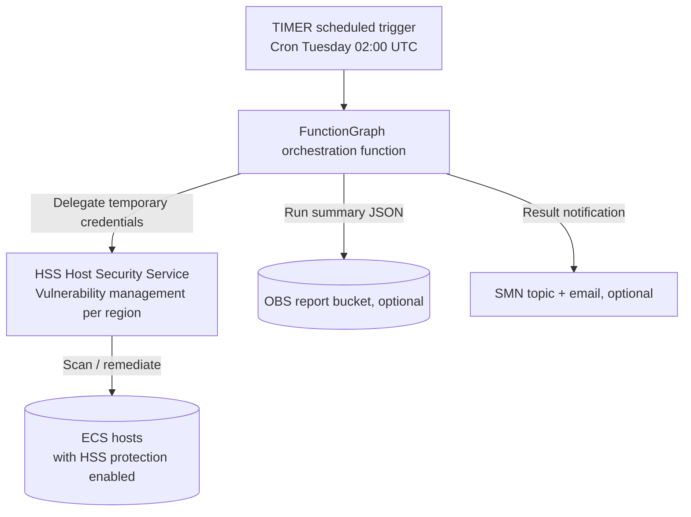

# deterministic-operations-scheduled-patch-management


## 1. Overview

### Overview

A best practice for "centralized, scheduled, cross-region host vulnerability scanning and remediation" based on **Huawei Cloud FunctionGraph + HSS (Host Security Service)**. A single orchestration function uniformly schedules host security vulnerability management capabilities across multiple regions, replacing manual inspection and remediation on each host. It is suited to O&M scenarios that require periodic compliance patching of a large number of ECS hosts.

---

## 2. Table of Contents

- [1. Overview](#1-overview)
- [2. Table of Contents](#2-table-of-contents)
- [3. Architecture Diagram](#3-architecture-diagram)
- [4. Highlights](#4-highlights)
- [5. Cloud Services Used](#5-cloud-services-used)
- [6. Prerequisites](#6-prerequisites)
- [7. Quick Start](#7-quick-start)
- [8. Step-by-Step Deployment](#8-step-by-step-deployment)
- [9. Usage / Verification](#9-usage--verification)
- [10. Cleanup](#10-cleanup)
- [11. Detailed Explanation](#11-detailed-explanation)
- [12. Dependencies](#12-dependencies)
- [13. FAQ / Troubleshooting](#13-faq--troubleshooting)
- [14. Contributing](#14-contributing)
- [15. License](#15-license)
- [16. Contact / Maintainers](#16-contact--maintainers)

```
README.md                # This file
LICENSE                  # MIT-0 license
docs/                    # Architecture description, deployment guide, response constraints
infra/                   # Terraform IaC + build/deploy scripts + cross-account modules
src/                     # FunctionGraph functions and HSS client
```

---

## 3. Architecture Diagram



---

## 4. Highlights

- **Single-point cross-region orchestration**: one FunctionGraph function schedules HSS across multiple regions; no extra agent is needed on the hosts.
- **Dual triggering by schedule and manually**: runs automatically on the default Cron schedule (Tuesday 02:00 UTC), and can also be triggered synchronously via SDK for immediate verification.
- **Multi-account extension**: deploy cross-account agencies through the `infra/modules/target-account-agency` submodule.
- **Auditable reports and email alerts**: each run's JSON report is written to OBS and a summary is pushed to SMN email subscriptions.

---

## 5. Cloud Services Used

This practice uses the following Huawei Cloud services:

| Service | Purpose |
|---|---|
| FunctionGraph (FGS) | Host for the orchestration function |
| HSS (Host Security Service) | Host vulnerability scanning and one-click remediation |
| IAM (Agency) | Cross-service delegation |
| OBS | Bucket for report JSON (optional) |
| SMN | Email notification topic (optional) |
| LTS | Function runtime log group/stream |

---

## 6. Prerequisites

- A Huawei Cloud account (with IAM administration permissions); default region `cn-north-4` (changeable).
- Locally: Terraform >= 1.5, Python >= 3.9.
- Target ECS hosts already exist and **HSS protection is enabled** in the target enterprise project (Professional/Enterprise/旗舰版 supports one-click vulnerability remediation).
- Credentials are provided only via environment variables (**never written to any file**):

```bash
export HW_ACCESS_KEY="<AK>"
export HW_SECRET_KEY="<SK>"
```

---

## 7. Quick Start

```bash
# 1) Build the function deployment package (with bundled huaweicloudsdk dependencies + missing-dependency/size guardrails)
python infra/build_function.py

# 2) Initialize and preview
terraform -chdir=infra init
terraform -chdir=infra plan

# 3) Apply (automatically falls back to SDK upload of the function code)
terraform -chdir=infra apply
```

---

## 8. Step-by-Step Deployment

1. **Build the function deployment package** (includes SDK dependencies + size guardrails)
   ```bash
   python infra/build_function.py
   ```
2. **Terraform initialization and preview**
   ```bash
   terraform -chdir=infra init
   terraform -chdir=infra plan
   ```
3. **Apply the deployment** (automatically falls back to SDK upload of the function code)
   ```bash
   terraform -chdir=infra apply
   ```
4. **Configure HSS protection on target hosts** (hosts in the enterprise project must have HSS Professional/Enterprise/旗舰版 enabled)
5. **Wait for the first Cron trigger** (or run the manual trigger verification in §9)

---

## 9. Usage / Verification

### Usage and Verification

**Manual trigger verification (bypassing the timer)**: invoke the function synchronously with the FunctionGraph SDK and fetch logs directly with `x_cff_log_type=tail`:

```bash
export HW_ACCESS_KEY="<AK>" HW_SECRET_KEY="<SK>"
python - <<'PY'
from huaweicloudsdkcore.auth.credentials import BasicCredentials
from huaweicloudsdkfunctiongraph.v2 import FunctionGraphClient, InvokeFunctionRequest
import os
c = (FunctionGraphClient.new_builder()
.with_endpoint("https://functiongraph.cn-north-4.myhuaweicloud.com")
.with_credentials(BasicCredentials(os.environ["HW_ACCESS_KEY"], os.environ["HW_SECRET_KEY"]))
.build())
req = InvokeFunctionRequest(); req.function_urn="<functions.outputs.function_urn>"; req.body="{}"
req.x_cff_log_type="tail"; req.x_cff_request_version="v1"
r = c.invoke_function(req); print(r.status, r.result, r.log)
PY
```

Expected `status=200`, and `result` contains `{"statusCode":200,"body":{"operation":...,"regions":[...]}}`
`regions` lists the number of protected hosts and the operations performed in each region.

**Scheduled trigger**: in the console under "FunctionGraph → Triggers" you can see `patch-schedule` (ACTIVE), or check the LTS log group for run logs triggered by Cron.

Common parameters (Terraform variables):

- `schedule_expression`: Cron (default `0 0 2 ? * TUE`, Tuesday 02:00 UTC)
- `target_regions`: list of target regions for patching (multiple regions)
- `target_accounts`: list of cross-account targets (requires deploying `modules/target-account-agency` first)
- `operation`: `Scan` (scan only) / `Install` (scan and remediate)
- `reboot_option`: `NoReboot` / `RebootIfNeeded`
- `enterprise_project_id`: the enterprise project that scopes the hosts

After deployment, follow these steps to verify that the business functionality works before considering the delivery complete.

---

## 10. Cleanup

```bash
terraform -chdir=infra destroy
```

> The OBS bucket does not have versioning enabled, so `destroy` can delete it normally; after destruction, it is recommended to check the console for leftover functions/LTS/EIP.

---

## 11. Detailed Explanation

- **Orchestration logic**: the TIMER trigger wakes the function according to Cron → the function reads the target regions/accounts/operation → builds an HSS client for each region and lists the protected hosts in the enterprise project → `Scan` triggers a scan / `Install` queries vulnerabilities and remediates in bulk → the summary is written to OBS (optional) and pushed to SMN (optional).
- **Multi-account**: HSS is isolated by account; for cross-account use, deploy the `infra/modules/target-account-agency` agency in the target account, and the function exchanges an IAM agency token for temporary credentials of the target account (a best-practice extension; see `src/functions/patch_orchestrator/index.py`).
- **Directory structure**:
```
infra/ Terraform IaC + build/deploy scripts + cross-account modules
src/ FunctionGraph functions and HSS client
docs/ architecture description / deployment guide / response constraints (quality gate)
```

---

## 12. Dependencies

- Runtime dependencies: `huaweicloudsdkcore` / `huaweicloudsdkhss` / `huaweicloudsdksmn` (packaged in the zip); `obs` (esdk-obs-python) is built into the FunctionGraph runtime environment.

---

## 13. FAQ / Troubleshooting

- **Function execution fails and the log is completely empty**: most likely the SDK was not packaged into the zip or a native module was mixed in. Re-run `python infra/build_function.py` (it exits with an error if the SDK is missing or the package is <200KB), then re-upload with `terraform apply -replace=huaweicloud_fgs_function.patch_orchestrator`.
- **HSS call returns 403**: check the agency role scope (HSS/OBS use global `domain_roles`, SMN uses regional `project_role`); after changing permissions, use `terraform apply -replace` to clear the cold-start instance.
- **OBS object write returns 403**: the OBS data plane does not accept agency credentials; allow access with the bucket policy `domain/<domain_id>:agency/<agency_name>`.
- **Changing the TIMER schedule reports FSS.1153**: attributes in the `timer{}` block are ForceNew; to change the schedule, use `terraform taint` to recreate the trigger.

---

## 14. Contributing

Issues are welcome for reporting problems or suggesting improvements. Please submit feedback through the project Issue channel.

---

## 15. License

The source code is released under the **MIT-0** (MIT No Attribution) license. See [LICENSE](./LICENSE).

---

## 16. Contact / Maintainers
| Item | Content |
|---|---|
| **Creator** | [dgc-git](https://github.com/dgc-git) |
| **Maintainer** | [dgc-git](https://github.com/dgc-git) |
| **Contact** | GitHub Issues / PR (see [Section 14](#14-contributing)) |
