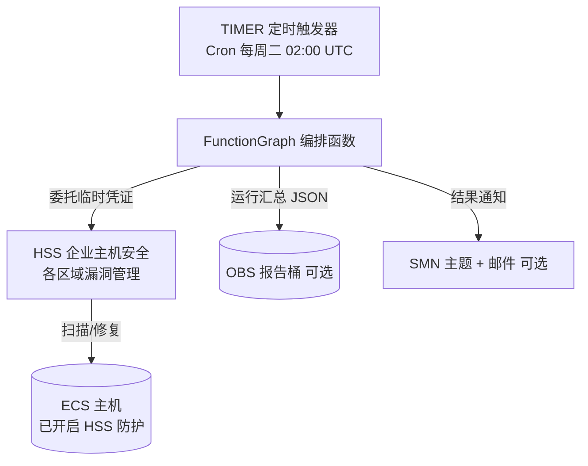

# deterministic-operations-scheduled-patch-management · 集中式多区域主机补丁编排（FunctionGraph + HSS）


## 1. 简介 / Overview

### 简介


一套基于 **华为云 FunctionGraph + HSS 企业主机安全** 的「集中式、按计划、跨区域主机漏洞扫描与修复」最佳实践。
以单一编排函数统一调度多个区域内的主机安全漏洞管理能力，替代在每台主机上手工巡检与修复，适用于需要对大量 ECS 主机做周期性合规补丁的运维场景。

---

## 2. 目录

- [1. 简介 / Overview](#1-简介--overview)
- [2. 目录](#2-目录)
- [3. 架构图](#3-架构图)
- [4. 方案亮点](#4-方案亮点)
- [5. 涉及云服务](#5-涉及云服务)
- [6. 前置条件](#6-前置条件)
- [7. 快速开始](#7-快速开始)
- [8. 分步部署](#8-分步部署)
- [9. 使用方法 / 验证](#9-使用方法--验证)
- [10. 清理资源](#10-清理资源)
- [11. 详细说明](#11-详细说明)
- [12. 依赖](#12-依赖)
- [13. FAQ / 故障排除](#13-faq--故障排除)
- [14. 贡献指南](#14-贡献指南)
- [15. 许可证](#15-许可证)
- [16. 联系方式 / 维护者](#16-联系方式--维护者)


```
README.md                # 本文件
LICENSE                  # MIT-0 许可证
docs/                    # 架构说明、部署指导书、响应约束
infra/                   # Terraform IaC + 构建/部署脚本 + 跨账号模块
src/                     # FunctionGraph 函数与 HSS 客户端
```

---

## 3. 架构图



---

## 4. 方案亮点

- **跨区域单点编排**：一个 FunctionGraph 函数统一调度多个区域的 HSS，主机侧无需安装额外 agent。
- **定时 + 手动双触发**：默认 Cron 周二 02:00 UTC 自动跑，也可用 SDK 同步触发立即验证。
- **多账号扩展**：通过 `infra/modules/target-account-agency` 子模块部署跨账号委托。
- **可审计报告 + 邮件告警**：每次运行的 JSON 报告落 OBS、汇总推送 SMN 邮件订阅。

---

## 5. 涉及云服务

本实践使用以下华为云服务：

| 服务 | 用途 |
|---|---|
| FunctionGraph（FGS） | 编排函数运行宿主 |
| HSS（企业主机安全） | 主机漏洞扫描与一键修复 |
| IAM（Agency） | 跨服务委托 |
| OBS | 报告 JSON 落地桶（可选） |
| SMN | 邮件通知主题（可选） |
| LTS | 函数运行日志组/流 |

---

## 6. 前置条件

- 华为云账号（具备 IAM 管理权限），默认区域 `cn-north-4`（可改）。
- 本地：Terraform >= 1.5、Python >= 3.9。
- 目标 ECS 主机已存在，并在目标企业项目内**开启 HSS 防护**（专业版/企业版/旗舰版支持漏洞一键修复）。
- 凭证仅经环境变量提供（**不写入任何文件**）：
```bash
export HW_ACCESS_KEY="<AK>"
export HW_SECRET_KEY="<SK>"
```

---

## 7. 快速开始

```bash
# 1) 构建函数部署包（自带 huaweicloudsdk 依赖 + 缺依赖/体积护栏）
python infra/build_function.py

# 2) 初始化并预览
terraform -chdir=infra init
terraform -chdir=infra plan

# 3) 应用（自动用 SDK 兜底上传函数代码）
terraform -chdir=infra apply
```

---

## 8. 分步部署

1. **构建函数部署包**（含 SDK 依赖 + 体积护栏）
   ```bash
   python infra/build_function.py
   ```
2. **Terraform 初始化与预览**
   ```bash
   terraform -chdir=infra init
   terraform -chdir=infra plan
   ```
3. **应用部署**（自动用 SDK 兜底上传函数代码）
   ```bash
   terraform -chdir=infra apply
   ```
4. **配置目标主机 HSS 防护**（企业项目内主机需开启 HSS 专业版/企业版/旗舰版）
5. **等待首次 Cron 触发**（或执行 §9 手动触发验证）

---

## 9. 使用方法 / 验证

### 使用方法与验证


**手动触发验证（绕过定时器）**：用 FunctionGraph SDK 同步调用函数，`x_cff_log_type=tail` 直取日志：
```bash
export HW_ACCESS_KEY="<AK>" HW_SECRET_KEY="<SK>"
python - <<'PY'
from huaweicloudsdkcore.auth.credentials import BasicCredentials
from huaweicloudsdkfunctiongraph.v2 import FunctionGraphClient, InvokeFunctionRequest
import os
c = (FunctionGraphClient.new_builder()
.with_endpoint("https://functiongraph.cn-north-4.myhuaweicloud.com")
.with_credentials(BasicCredentials(os.environ["HW_ACCESS_KEY"], os.environ["HW_SECRET_KEY"]))
.build())
req = InvokeFunctionRequest(); req.function_urn="<functions.outputs.function_urn>"; req.body="{}"
req.x_cff_log_type="tail"; req.x_cff_request_version="v1"
r = c.invoke_function(req); print(r.status, r.result, r.log)
PY
```
预期 `status=200`，`result` 含 `{"statusCode":200,"body":{"operation":...,"regions":[...]}}`
`regions` 列出各区域防护主机数与执行的操作。

**定时触发**：控制台「函数工作流 → 触发器」可见 `patch-schedule`（ACTIVE），或到 LTS 日志组查看按 Cron 触发的运行日志。

常用参数（terraform 变量）：
- `schedule_expression`：Cron（默认 `0 0 2 ? * TUE`，UTC 周二 02:00）
- `target_regions`：补丁目标区域列表（多区域）
- `target_accounts`：跨账号目标列表（需先部署 `modules/target-account-agency`）
- `operation`：`Scan`（仅扫描） / `Install`（扫描并修复）
- `reboot_option`：`NoReboot` / `RebootIfNeeded`
- `enterprise_project_id`：圈定主机范围的企业项目

部署完成后请按本节步骤自行验证，确认业务功能可用，方可视为交付完成。

---

## 10. 清理资源

```bash
terraform -chdir=infra destroy
```
> OBS 桶未开版本控制，`destroy` 可正常删除；销毁后建议控制台确认无残留函数/LTS/EIP。

---

## 11. 详细说明

- **编排逻辑**：TIMER 触发器按 Cron 唤起函数 → 函数读取目标区域/账号/操作 → 逐区域构建 HSS 客户端
列出企业项目内防护主机 → `Scan` 触发扫描 / `Install` 查询漏洞后批量修复 → 汇总写入 OBS（可选）并推送 SMN（可选）。
- **多账号**：HSS 按账号隔离；跨账号需在目标账号内部署 `infra/modules/target-account-agency` 委托
函数经 IAM agency token 交换获取目标账号临时凭证（最佳实践扩展，详见 `src/functions/patch_orchestrator/index.py`）。
- **目录结构**：
```
infra/ Terraform IaC + 构建/部署脚本 + 跨账号模块
src/ FunctionGraph 函数与 HSS 客户端
docs/ 架构说明 / 部署指导书 / 响应约束（质量门禁）
```

---

## 12. 依赖

- 运行期依赖：`huaweicloudsdkcore` / `huaweicloudsdkhss` / `huaweicloudsdksmn`（随 zip 打包）；
`obs`（esdk-obs-python）为 FunctionGraph 运行环境内置。

---

## 13. FAQ / 故障排除

### FAQ


- **函数执行失败 + 日志全空**：多半是 zip 未打入 SDK 或混入了原生模块。重新运行 `python infra/build_function.py`
（缺 SDK / <200KB 会直接报错退出），并用 `terraform apply -replace=huaweicloud_fgs_function.patch_orchestrator` 重传。
- **HSS 调用 403**：检查 agency 角色作用域（HSS/OBS 用 `domain_roles` 全局，SMN 用 `project_role` 区域）
改完权限后 `terraform apply -replace` 清实例冷启动。
- **OBS 写对象 403**：OBS 数据面不认 agency 凭证，需桶策略 `domain/<domain_id>:agency/<agency_name>` 放行。
- **TIMER 改调度报错 FSS.1153**：`timer{}` 块属性为 ForceNew，改调度请 `terraform taint` 重建触发器。

---

## 14. 贡献指南

欢迎提交 Issue 反馈问题或改进建议。请通过项目 Issue 渠道提交反馈。

---

## 15. 许可证

源码以 **MIT-0**（MIT No Attribution）许可证发布。详见 [LICENSE](./LICENSE)。

---

## 16. 联系方式 / 维护者
| 项 | 内容 |
|---|---|
| **创建者** | [dgc-git](https://github.com/dgc-git) |
| **维护者** | [dgc-git](https://github.com/dgc-git) |
| **联系方式** | GitHub Issues / PR（见[第 14 节](#14-贡献指南)） |
