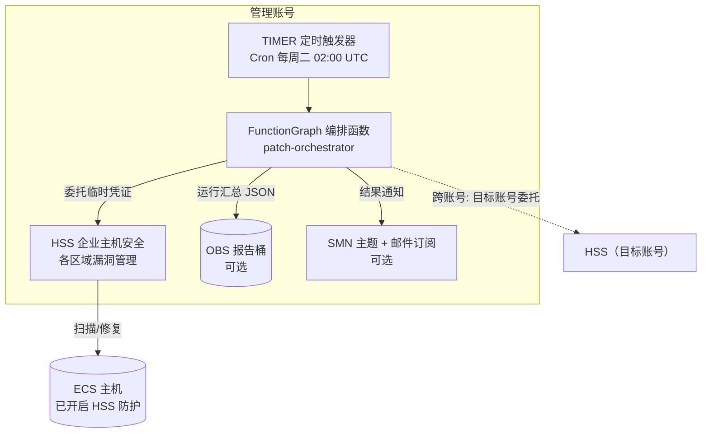

# 华为云集中式多区域主机补丁编排 · 架构说明

> 一套基于 FunctionGraph + HSS 的「集中式、按计划、跨区域主机漏洞扫描与修复」最佳实践。
> 以单一编排函数统一调度多区域内的主机安全（HSS）漏洞管理能力，替代在每台主机上手工巡检与修复。

## 1. 架构图

## 2. 组件与职责

| 组件 | 华为云服务 | 职责 |
|------|-----------|------|
| 定时触发 | FunctionGraph **TIMER 触发器** | 按 Cron 唤起编排函数 |
| 编排函数 | **FunctionGraph** | 读取目标区域/账号/操作，逐区域调用 HSS 执行扫描/修复，汇聚结果 |
| 主机安全 | **HSS 企业主机安全** | 漏洞扫描与一键修复（Linux/Windows 系统漏洞），真正的「打补丁」执行者 |
| 委托 | **IAM Agency**（`op_svc_cff`） | 让函数以最小权限调用 HSS / OBS / SMN |
| 报告 | **OBS**（可选） | 每次运行汇总报告落地，便于审计 |
| 通知 | **SMN**（可选） | 运行结果推送到邮件订阅 |
| 日志 | **LTS** | 函数运行日志集中留存 |

## 3. 工作原理

1. TIMER 触发器在设定时间触发编排函数（Cron，UTC）。
2. 函数从环境变量读取 `TARGET_REGIONS`、`OPERATION`（Scan/Install）、`REBOOT_OPTION` 等。
3. 函数以委托临时凭证逐区域构建 HSS 客户端，列出企业项目内的防护主机。
4. `Scan` → 触发漏洞扫描；`Install` → 查询漏洞后批量修复（可按需重启）。
5. 汇总结果写入 OBS（可选）并推送 SMN（可选）。

## 4. 区域与账号模型

- **多区域**：HSS 为区域级服务，函数在管理账号内对 `TARGET_REGIONS` 逐一调用，天然支持跨区域集中调度。
- **多账号**：HSS 按账号隔离。跨账号需在目标账号内部署 `infra/modules/target-account-agency` 委托
函数经 IAM agency token 交换获取目标账号临时凭证后调用其 HSS（详见 `src/functions/patch_orchestrator/index.py` 跨账号分支）。

## 5. 目标主机前提

本方案**不创建** ECS / 不开通 HSS 配额，假定目标主机已存在并已在目标企业项目内开启 HSS 防护。
未被 HSS 防护的主机不会出现在 `ListHosts` 结果中，编排函数会跳过该范围并给出提示。
